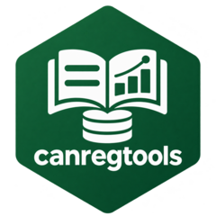

<!-- README.md is generated from README.Rmd. Please edit that file -->

```{r, include = FALSE}
knitr::opts_chunk$set(
  collapse = TRUE,
  comment = "#>",
  fig.path = "man/figures/README-",
  out.width = "100%"
)
options(tibble.print_min = 5, tibble.print_max = 5)
```


# canregtools 

<!-- badges: start -->
[](https://CRAN.R-project.org/package=canregtools)
[](https://github.com/gigu003/canregtools/actions/workflows/R-CMD-check.yaml)
[](https://codecov.io/gh/gigu003/canregtools)
<!-- badges: end -->


## Overview
Canregtools is an R package designed to streamline the analysis workflow for Population-Based Cancer Registry (PBCR) data. It aims to improve the efficiency, accuracy, and reproducibility of cancer registry data processing, thereby supporting standardized, and routine PBCR analytical workflows.

## Install
Currently, the package is not available on CRAN, but you can install the development version of canregtools from [https://gigu003.r-universe.dev/](https://gigu003.r-universe.dev/).

``` r
install.packages('canregtools', repos = c('https://gigu003.r-universe.dev', 'https://cloud.r-project.org'))
```

## View the vignette

After installing `canregtools`, list the available vignettes or open the main
user guide directly:

```{r, eval = FALSE}
browseVignettes("canregtools")
vignette("using-canregtools", package = "canregtools")
```

The vignette explains the `canreg` and `fbswicd` objects, data-management
functions such as `cr_select()` and `cr_filter()`, and the workflow for
calculating rates and quality indicators. It is also available in the package
website at
[`articles/using-canregtools.html`](https://gigu003.github.io/canregtools/articles/using-canregtools.html).

## Usage

```{r, eval = FALSE}
library(canregtools)
data("canregs")
registry <- canregs[[1]]
summary_object <- count_canreg(registry, cancer_type = "big")

asr <- create_asr(summary_object, year, sex, cancer)
quality <- create_quality(summary_object, cancer)
age_rate <- create_age_rate(summary_object)
```

Registry dictionaries can be isolated by project. User overrides are combined
with built-in defaults and take effect immediately:

```{r, eval = FALSE}
options(canregtools.dict_dir = file.path("config", "canregtools"))
mapping <- data.frame(
  regicode = c("410103", "410307"),
  area_type = c("910000", "920000"),
  hdi = c("high", "low")
)
cr_map(mapping, attr = c("area_type", "hdi"))
ls_dict("hdi")
```

Use `write_regicode()` for multilingual registry labels and `reset_dict()` to
clear overrides with a backup. Legacy files are backed up on their next update;
see the vignette for migration details.

The main workflow is:

```text
Excel/data frames -> canreg(s) -> fbswicd(s)
                  -> rates, quality indicators, and reports
```

For detailed input requirements, data-management functions, validation, and
reproducible analysis options, see the
[`using-canregtools` vignette](https://gigu003.github.io/canregtools/articles/using-canregtools.html).


